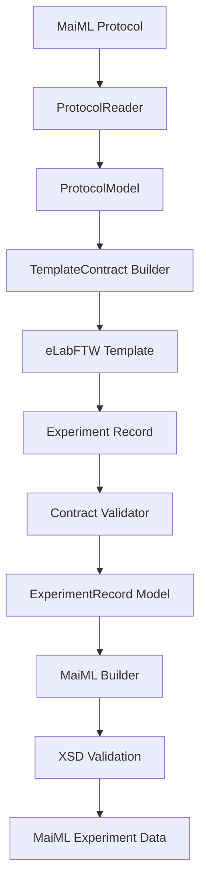

# MaiML Template Contract 設計構想

> Status: Draft v0.1  
> 対象プロジェクト: `MaiML-Sandbox/MaiML2eLabFTW` / `elabftw2MaiML`  
> 目的: MaiML Protocolから生成したeLabFTW Templateに従って実験を記録すれば、後から実験データをMaiMLへ過不足なく変換できる仕組みを定義する。

## 1. 背景

現在の`MaiML2eLabFTW`では、MaiML Protocolから主に次の情報をeLabFTW Experiment Templateへ変換できる。

- `property`
- `content`
- `insertion`
- `instruction`から生成したSteps
- PNMLから決定したStep順序
- 逆変換用のID・UUID・参照関係

しかし、実験実施後のeLabFTW記録から完全なMaiML実験データを生成するには、汎用データコンテナと添付だけでは不足する。

追加で考慮すべき主な情報は次のとおりである。

- document情報
- creator / owner / vendor
- instrument
- protocol / method / program
- material / condition / resultの実体とUUID
- Template定義と実データの対応
- place / transitionとの対応
- 実施日時と実施者
- Stepの実施状態
- 既存Materialまたは前工程Resultとの同一性・参照関係
- eventLog
- insertionの実体、形式、ハッシュ
- UUIDを新規発行するか既存UUIDを再利用するかという規則

本設計では、MaiML Protocolを単なるフォーム定義ではなく、MaiML実験データを作成するための「記録仕様書」として利用する。

## 2. 目標

MaiML Protocolの読込み時に、次を明示できることを目標とする。

> このTemplateに従って記録すれば、MaiMLへ変換するために必要な情報が揃う。

変換処理は次の状態を判定できなければならない。

- 必要な情報がすべて記録されている
- 必須情報が不足している
- MaiMLへ対応付けられない記録が存在する
- 複数の候補が競合している
- UUIDまたは参照関係が確定できない
- 添付ファイルの実体またはハッシュを確認できない

## 3. Template Contract

MaiML ProtocolからeLabFTW Templateを生成するとき、Custom FieldsやStepsと同時に`TemplateContract`を生成する。

`TemplateContract`は、各情報について次を定義する。

- どのMaiML要素・属性へ格納するか
- どこから値を取得するか
- 必須か任意か
- 多重度
- 値の型と検証規則
- eLabFTW上の入力・保存場所
- UUIDの発行・再利用方針
- 欠損時の動作

### 3.1 YAML例

```yaml
version: 1

source:
  document_uuid: "..."
  method_uuid: "..."
  mapping_version: "1"

requirements:
  - id: sample_name
    maiml_target: material/property
    semantic_key: KYL:SampleName
    source: user_input
    required: true
    cardinality: "1"
    field_type: text
    elabftw_binding:
      kind: custom_field
      group: MATERIAL
      name: SampleName

  - id: instrument
    maiml_target: document/instrument
    source: user_selection
    required: true
    cardinality: "1"
    identity_policy: reuse_uuid

  - id: acquisition_time
    maiml_target: data/dateTime
    source: system
    required: true
    cardinality: "1"

  - id: result_image
    maiml_target: result/insertion
    source: attachment
    required: true
    cardinality: "1..*"
    accepted_formats:
      - image/tiff
```

## 4. 情報の取得元

すべてのMaiML情報をユーザー入力欄にする必要はない。各情報について取得元を明示する。

| 取得元 | 説明 | 例 |
|---|---|---|
| `protocol` | Protocolから固定的に取得 | method UUID、program、PNML、型、単位 |
| `eln_system` | eLabFTWから自動取得 | 実験ID、作成者、作成日時、更新日時 |
| `user_input` | ユーザーが直接入力 | 試料名、条件、結果値 |
| `user_selection` | 候補からユーザーが選択 | instrument、既存Material、前工程Result |
| `attachment` | 添付ファイルから取得 | 測定画像、装置出力、ログ |
| `generated` | 変換システムが生成 | 新規UUID、ハッシュ、eventLog |
| `reused_identity` | 既存実体の識別子を再利用 | 同じ試料、前工程Result |
| `derived` | 他の構造から決定論的に導出 | Stepとtransitionの対応 |

取得元を分離することで、不要な入力欄の増加と必要情報の記録漏れを防ぐ。

## 5. instrument

### 5.1 ProtocolからeLabFTWへの配置

`document/instrument`は原則としてCustom Fieldへ直接変換せず、次のように扱う。

- 人が読む装置名・説明: Main Textの「装置情報」
- 装置のID、UUID、property、content、insertion: `maiml-metadata.json`
- 実験時に使用した装置の確定: 固定値またはユーザー選択

`document/instrument`は文書内の装置定義であり、必ずしも当該methodで使用された装置とは限らない。そのため、参照関係が確認できない場合は「使用装置」と断定せず「装置情報」と表示する。

### 5.2 表示例

```markdown
## 装置情報

- SEM
  - MaiML ID: instrumentID001
```

### 5.3 metadata例

```json
{
  "maiml": {
    "instruments": [
      {
        "id": "instrumentID001",
        "uuid": "47735598-e25d-4d26-951c-a9b59938446d",
        "name": "SEM",
        "description": null,
        "annotation": null,
        "properties": [],
        "contents": [],
        "insertions": []
      }
    ]
  }
}
```

`creator/instrumentRef`等が存在する場合は、参照要素自身のIDと参照先instrument IDを保持する。

## 6. descriptionの配置

descriptionは多くの場合、実験値ではなく入力支援情報として使用する。

| MaiML上の位置 | eLabFTWでの表示・保存先 |
|---|---|
| `document/description` | Main Textの「文書情報」 |
| `protocol/description` | Main Textの「プロトコル概要」 |
| `method/description` | Main Textの「手法概要」 |
| `program/description` | Main Textの「プログラム」 |
| `instruction/description` | 対応するStep本文 |
| 各Templateの`description` | Main TextのTemplate説明 |
| property/contentの`description` | Custom Fieldの`description` |
| instrumentの`description` | Main Textの「装置情報」 |
| PNML/place/transition/arcの`description` | 原則`maiml-metadata.json` |

### 6.1 Main Text構成例

```markdown
## 文書情報

<document/description>

## プロトコル概要

<protocol/description>

## 手法概要

<method/description>

## 装置情報

- <instrument/name>

## プログラム

### <program/name>

<program/description>

## 入力項目について

### MATERIAL

<materialTemplate/description>
```

空のdescriptionに対して空見出しを大量生成しない。値が存在するsectionだけを表示する。

## 7. UUIDと実体の同一性

同じ実体であれば、工程が変わっても新しいUUIDを機械的に発行してはならない。

例えば、前工程で生成されたResultを後工程の入力として使用する場合、同じ実体のUUIDを引き継ぐ。名称が同じという理由だけで新しいMaterialを生成したり、既存実体を別物として扱ったりしない。

### 7.1 identity policy

```yaml
identity_policy:
  mode: one_of
  choices:
    - generate_new
    - reuse_existing
    - reference_protocol_entity
    - reuse_previous_result
```

### 7.2 eLabFTWでの選択例

```text
試料の由来

○ 新規試料
○ 既存Materialを使用
○ 前工程のResultを使用
```

UUID再利用は自動的な名前一致だけで決定せず、明示された参照、Protocol定義、ユーザー選択または確実なシステム情報に基づいて決定する。

## 8. Material / Condition / Result

各Templateから実験データを生成するには、Template定義と実体を分離して管理する。

| 情報 | Protocol Template | 実験記録 |
|---|---|---|
| 型・semantic key | 固定 | Protocolから継承 |
| 単位 | 固定または候補 | 実際に使用した単位 |
| 値 | 初期値または空 | ユーザー入力・装置出力 |
| UUID | Template UUID | 実体UUID |
| placeRef | 工程上の位置 | 実体と工程の対応 |
| insertion要件 | 形式・多重度 | 実際の添付 |

Template UUIDを実験実体のUUIDとしてそのまま流用しない。実体が既存の場合はそのUUIDを再利用し、新規実体の場合のみ新規UUIDを発行する。

## 9. insertion

Template Contractでは、添付について少なくとも次を定義する。

- 必須・任意
- 最小・最大件数
- 許可するMIME typeまたは拡張子
- URIの解決方針
- ハッシュ方式
- 空ファイルの許可
- MaiML上の格納先
- 対応するTemplate / Step / Result

```yaml
- id: sem_image
  maiml_target: result/insertion
  source: attachment
  required: true
  cardinality: "1..*"
  accepted_formats:
    - image/tiff
  hash:
    required: true
    algorithm: sha256
  allow_empty: false
```

添付ファイルはアップロード前後でハッシュを検証する。相対URIは元MaiMLファイルの親ディレクトリを基準として安全に解決し、許可範囲外のパス参照を拒否する。

## 10. 完全性検証

「過不足ない」はXSD検証だけでは判断できない。検証を次の3層に分ける。

| 検証 | 確認内容 |
|---|---|
| Schema validation | 生成XMLがMaiML XSDに適合するか |
| Protocol contract validation | Protocolが要求した値・添付・関係が揃っているか |
| Conversion completeness validation | 変換時に情報を黙って破棄・推測していないか |

### 10.1 検証レポート例

```json
{
  "schema_valid": true,
  "contract_complete": false,
  "missing": [
    {
      "requirement_id": "instrument",
      "target": "document/instrument",
      "reason": "instrument was not selected"
    }
  ],
  "conflicts": [],
  "unmapped": [],
  "warnings": []
}
```

### 10.2 欠損時の動作

初期実装では、必須情報が不足している場合はMaiML生成を中止する。

将来的には設定によって次を選択可能にできる。

- `strict`: 変換中止
- `draft`: incomplete状態のドラフトを生成
- `interactive`: ユーザーに追加入力を要求

不明な値を推測してMaiMLへ補完してはならない。

## 11. 推奨モデル

```python
from dataclasses import dataclass
from enum import StrEnum


class CaptureSource(StrEnum):
    PROTOCOL = "protocol"
    ELN_SYSTEM = "eln_system"
    USER_INPUT = "user_input"
    USER_SELECTION = "user_selection"
    ATTACHMENT = "attachment"
    GENERATED = "generated"
    REUSED_IDENTITY = "reused_identity"
    DERIVED = "derived"


class IdentityPolicy(StrEnum):
    GENERATE_NEW = "generate_new"
    REUSE_EXISTING = "reuse_existing"
    REFERENCE_PROTOCOL_ENTITY = "reference_protocol_entity"
    REUSE_PREVIOUS_RESULT = "reuse_previous_result"


@dataclass(frozen=True)
class ValidationRule:
    rule_type: str
    parameters: dict[str, object]


@dataclass(frozen=True)
class ElabftwBinding:
    kind: str
    group: str | None = None
    name: str | None = None


@dataclass(frozen=True)
class CaptureRequirement:
    requirement_id: str
    maiml_target: str
    source: CaptureSource
    required: bool
    cardinality: str
    semantic_key: str | None
    identity_policy: IdentityPolicy | None
    validation_rules: tuple[ValidationRule, ...]
    elabftw_binding: ElabftwBinding | None


@dataclass(frozen=True)
class TemplateContract:
    document_uuid: str
    method_uuid: str
    mapping_version: str
    requirements: tuple[CaptureRequirement, ...]
```

## 12. 処理フロー



`TemplateContract Builder`は次を生成する。

- 固定情報
- 必須入力
- 自動取得項目
- UUID規則
- 添付要件
- eLabFTWとのbinding
- 完全性検証規則

## 13. 逆変換時の優先順位

eLabFTW ExperimentからMaiMLへ戻すときは、次の順序で値と意味を確定する。

1. Template Contract
2. 元MaiML Protocol定義
3. eLabFTWのCustom Fields / Steps / attachments
4. eLabFTWのシステム情報
5. 明示された参照・UUID
6. Rule-based解析
7. LLM補完

RuleまたはLLMで補完した値には、根拠、抽出元、confidenceを付与する。LLMの判断だけで既存UUIDの再利用を確定してはならない。

## 14. 元記録の保持

AI・ルールによる補完を行った場合でも、原記録と照合できるようにする。

- 元の`.eln`をMaiMLの`insertion`として保持
- 元eLabFTW Experimentのexportを添付
- 補完値のsource textを記録
- 抽出方法とconfidenceを記録
- 再解析可能な状態を維持

AIの出力を正解として固定せず、原記録と比較可能な構造化結果として扱う。

## 15. 実装順序

### Phase 1: Contract基盤

1. `CaptureSource`
2. `IdentityPolicy`
3. `CaptureRequirement`
4. `TemplateContract`
5. Contract用JSON Schema

### Phase 2: 基本情報

1. instrument
2. document / creator / owner / vendor
3. method / program / instruction description
4. eLabFTWシステム情報とのbinding

### Phase 3: 実体とUUID

1. Material / Condition / Resultの実体モデル
2. 新規UUID発行
3. 既存UUID再利用
4. 前工程Resultの参照
5. 同一性競合の検出

### Phase 4: 添付と実行記録

1. insertion要件
2. MIME type検証
3. ハッシュ検証
4. 実施日時・実施者
5. Step実施状態
6. eventLog

### Phase 5: 完全性検証

1. Contract Validator
2. 欠損レポート
3. 競合レポート
4. unmapped情報の検出
5. XSD検証との統合

## 16. 最小テスト

1. Protocolの必須propertyがContractへ反映される
2. instrumentが固定値または選択項目になる
3. method/program/instruction descriptionが適切な表示先へ入る
4. eLabFTW作成者と日時が自動取得項目になる
5. 必須Custom Fieldが空なら変換を中止する
6. 必須insertionがなければ変換を中止する
7. MIME type不一致を検出する
8. 添付ハッシュ不一致を検出する
9. 新規実体に新規UUIDを発行する
10. 既存実体のUUIDを再利用する
11. 前工程Resultを同じUUIDで参照する
12. 名前一致だけではUUIDを再利用しない
13. 未使用のeLabFTWフィールドを`unmapped`として報告する
14. Contractを満たす記録からXSD適合MaiMLを生成する
15. LLM補完値に根拠とconfidenceを保持する

## 17. 完了条件

次のすべてを満たしたとき、「MaiML Protocolに基づく過不足のない記録」と判定する。

- 必須Requirementがすべて解決済み
- 多重度を満たしている
- 型・単位・列挙値が有効
- UUID方針が確定している
- ID/refに参照切れがない
- 必須添付が存在する
- 添付形式とハッシュが有効
- 変換対象外の情報が黙って破棄されていない
- 競合が未解決のまま残っていない
- 生成MaiMLが公式XSDに適合する

この仕組みにより、MaiML Templateは単なる入力フォームではなく、MaiML実験データを正しく生成するための実行可能な記録仕様書となる。
